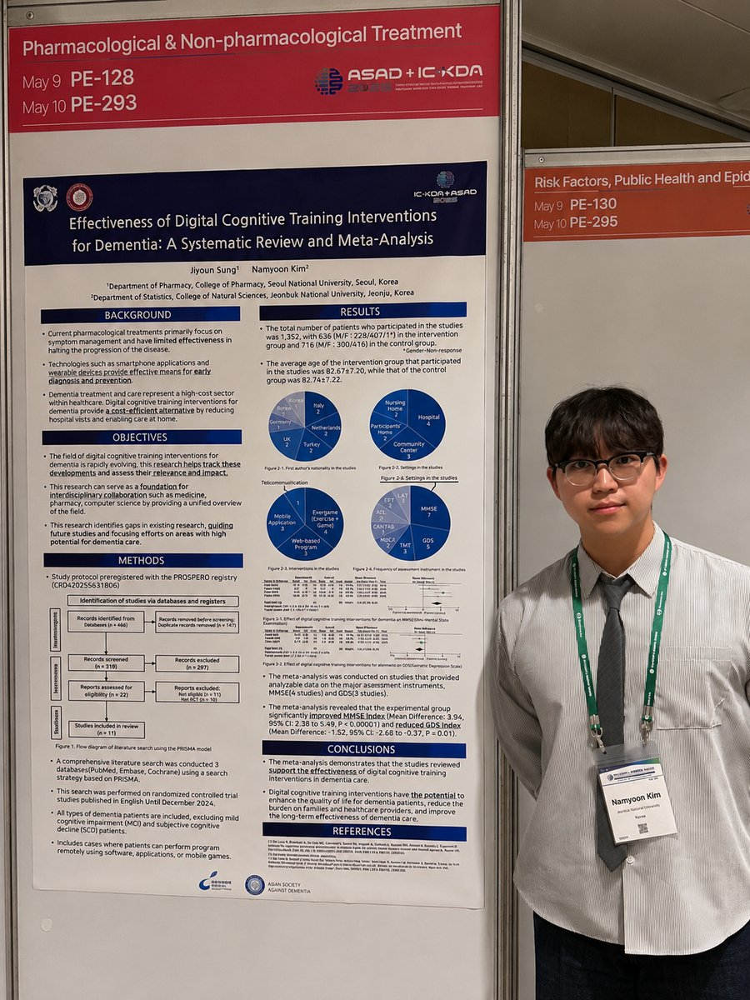
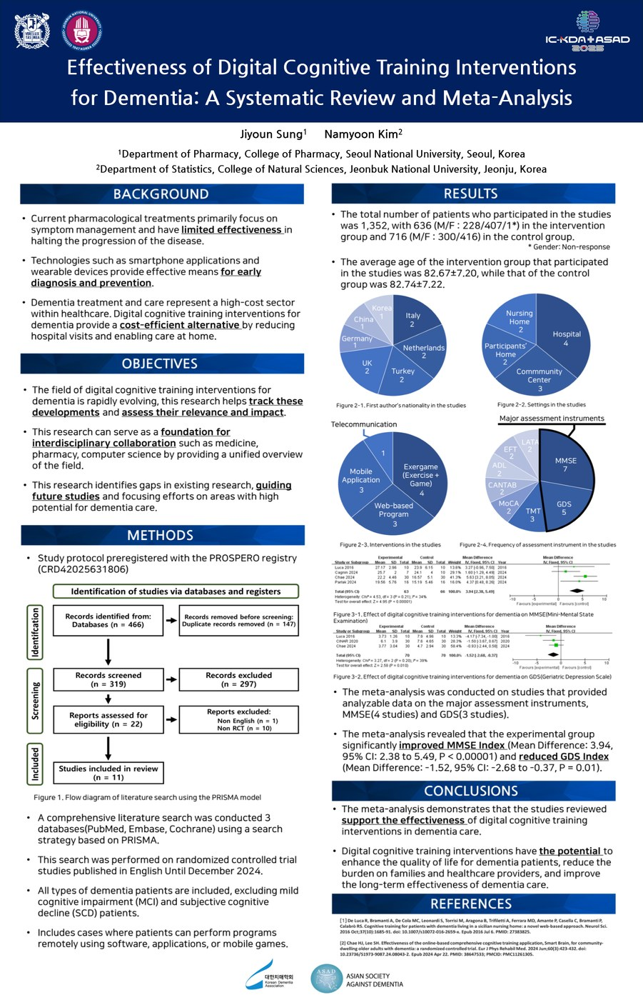
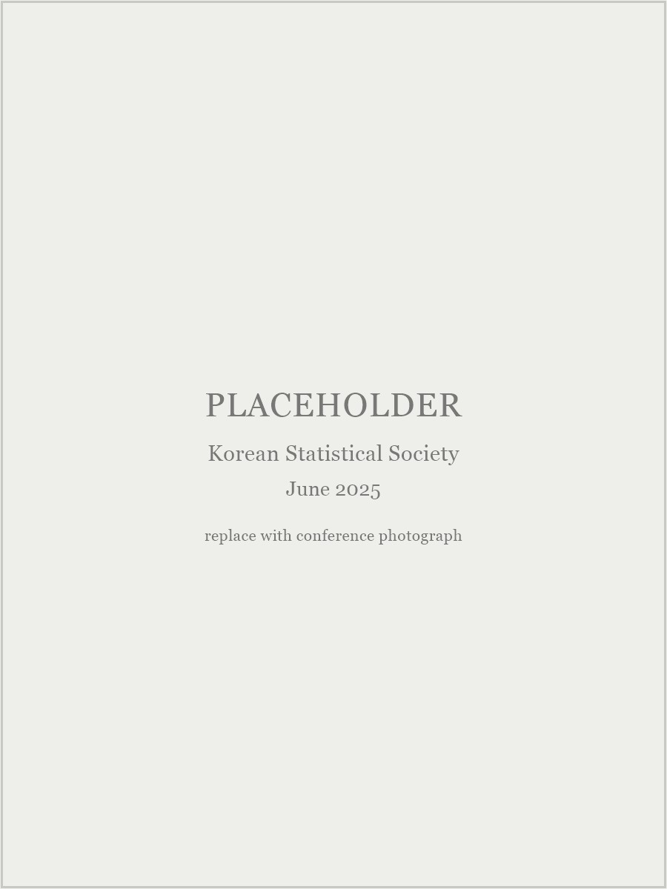
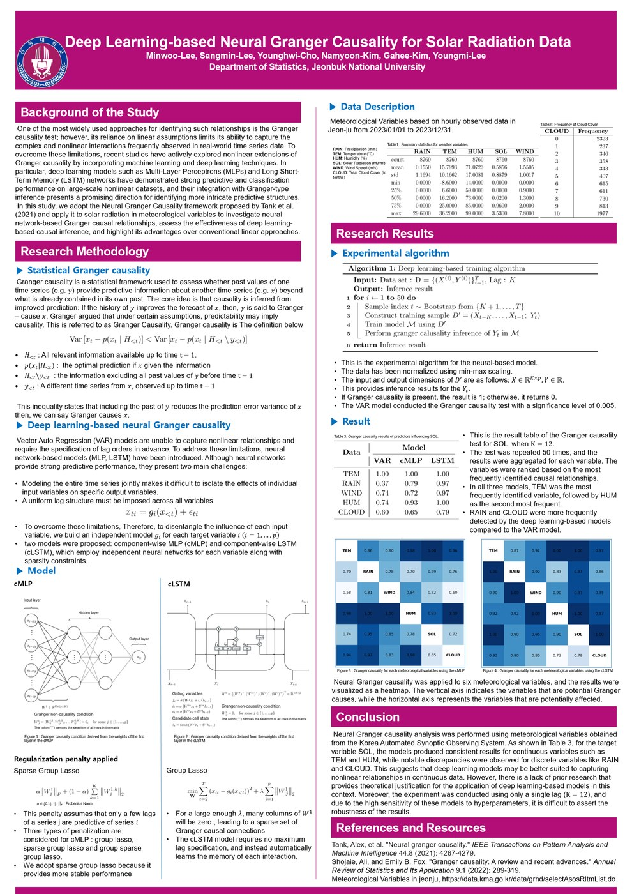
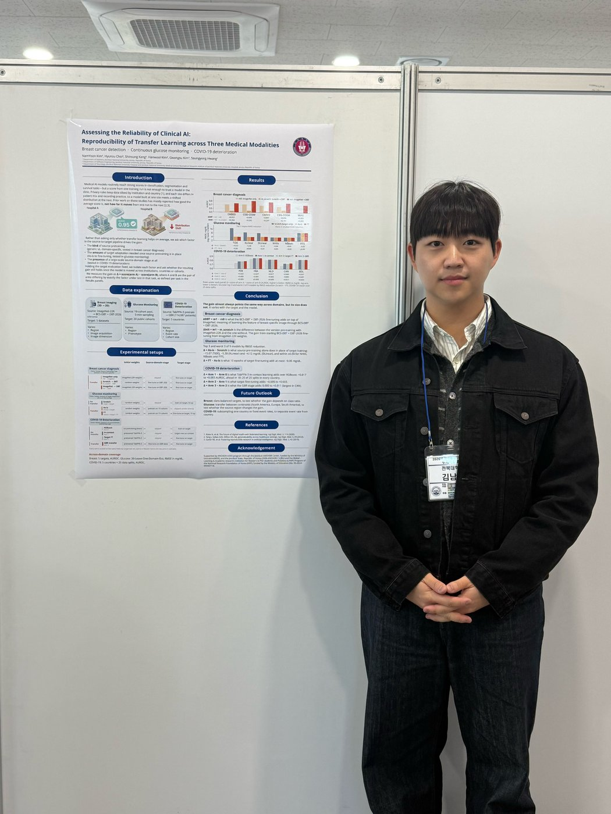
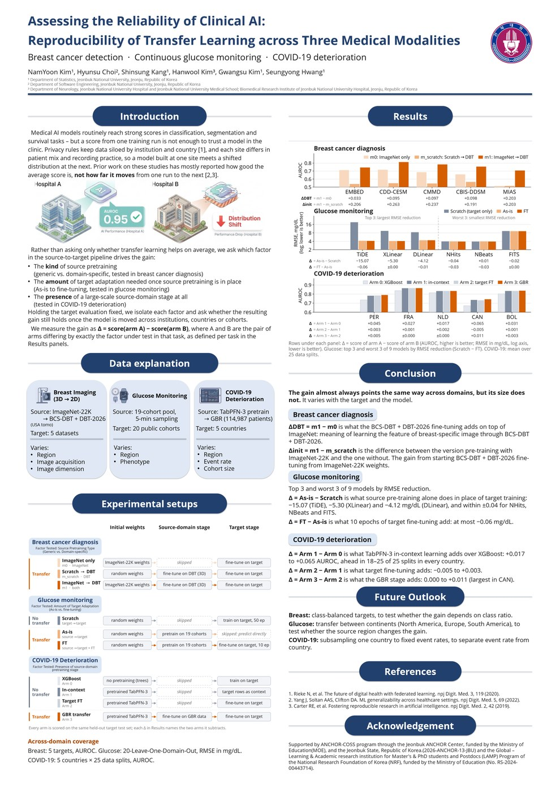
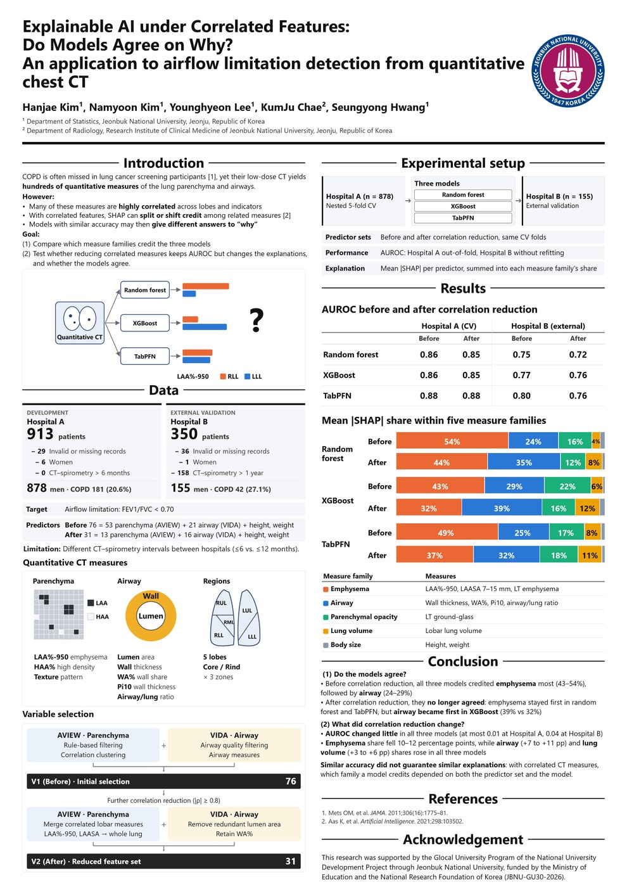
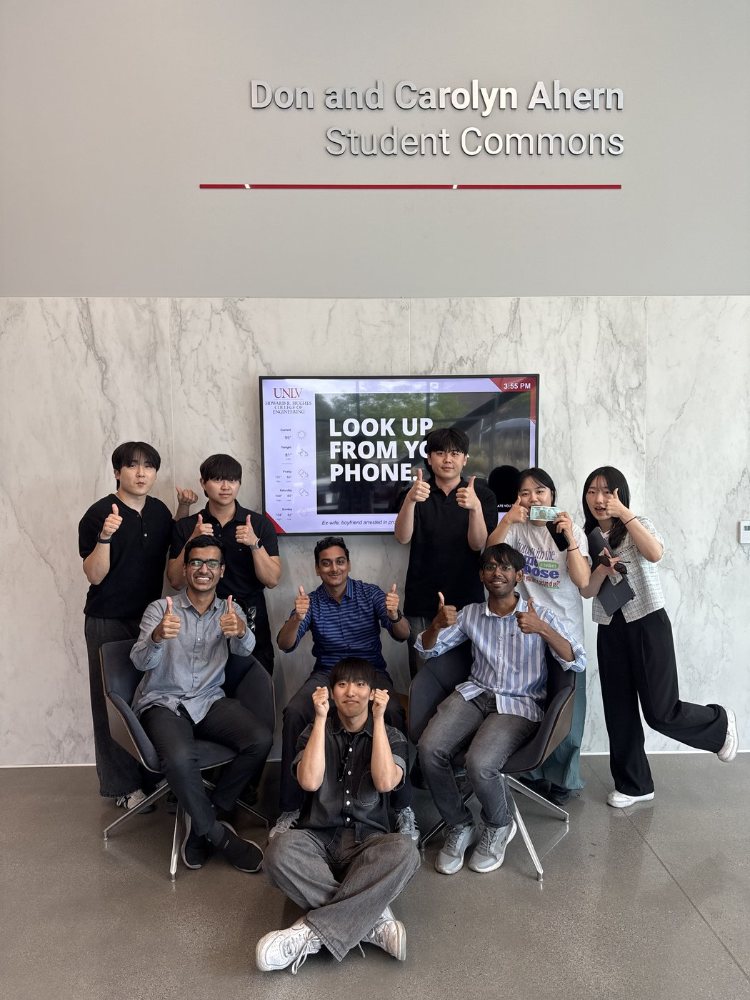

## Conference presentations

::: {.photo-entry}

::: {.photo-media .photo-pair}
{fig-alt="Nam-Yoon Kim standing beside the dementia meta-analysis poster at IC-KDA + ASAD 2025"}
{fig-alt="Conference poster: Effectiveness of Digital Cognitive Training Interventions for Dementia — A Systematic Review and Meta-Analysis, by Jiyoun Sung and Nam-Yoon Kim"}
:::

::: {.photo-body}
### 2025. 05. {.photo-title}

- Poster presentation, **IC-KDA + ASAD 2025 @ Seoul**
- **Best Poster Award**
:::

::: {.photo-action}
[Poster PDF](files/poster-dementia-2025.pdf){.photo-btn target="_blank"}
:::

:::

::: {.photo-entry}

::: {.photo-media .photo-pair}
{fig-alt="Nam-Yoon Kim standing beside the neural Granger causality poster at the Korean Statistical Society Summer Conference"}
{fig-alt="Conference poster: Deep Learning-based Neural Granger Causality for Solar Radiation Data, by Minwoo Lee, Sangmin Lee, Younghwi Cho, Nam-Yoon Kim, Gahee Kim and Youngmi Lee"}
:::

::: {.photo-body}
### 2025. 06. {.photo-title}

- Poster presentation, **Korean Statistical Society Summer Conference @ Gyeongju**
:::

::: {.photo-action}
[Poster PDF](files/poster-granger-2025.pdf){.photo-btn target="_blank"}
:::

:::

::: {.photo-entry}

::: {.photo-media .photo-pair}
{fig-alt="Nam-Yoon Kim beside the transfer learning reproducibility poster at the Korean Data and Information Science Society, Busan"}
{fig-alt="Conference poster: Assessing the Reliability of Clinical AI — Reproducibility of Transfer Learning across Three Medical Modalities"}
:::

::: {.photo-body}
### 2026. 11. {.photo-title}

- Poster presentation, **Korean Data and Information Science Society @ Busan**
- *Assessing the Reliability of Clinical AI: Reproducibility of Transfer Learning
  across Three Medical Modalities*
- **Honorable Mention Award**
:::

::: {.photo-action}
[Poster PDF](files/poster-reproducibility-2026.pdf){.photo-btn target="_blank"}
:::

:::

::: {.photo-entry}

::: {.photo-media .photo-pair}
<!-- PLACEHOLDER: the photograph from the day goes here, beside the poster.
     Drop the file into images/ and uncomment:
{fig-alt="Nam-Yoon Kim beside the explainable AI poster at the Korean Data and Information Science Society, Busan"}
-->
{fig-alt="Conference poster: Explainable AI under Correlated Features — Do Models Agree on Why? An application to airflow limitation detection from quantitative chest CT"}
:::

::: {.photo-body}
### 2026. 11. {.photo-title}

- Poster presentation, **Korean Data and Information Science Society @ Busan**
- *Explainable AI under Correlated Features: Do Models Agree on Why? An
  Application to Airflow Limitation Detection from Quantitative Chest CT*
:::

::: {.photo-action}
[Poster PDF](files/poster-airway-ct-2026.pdf){.photo-btn target="_blank"}
:::

:::

## Research visits

::: {.photo-entry}

::: {.photo-media}
{fig-alt="Group photograph of the summer research programme participants at the Don and Carolyn Ahern Student Commons, UNLV"}
:::

::: {.photo-body}
### 2025. 06. – 07. {.photo-title}

- Summer research program, **University of Nevada, Las Vegas**
- Supervised by Dr. Mingon Kang
:::

:::

## Other activities

PLACEHOLDER: anything else worth showing — student statistics society, seminars
or reading groups, data competitions, volunteering, tutoring, or departmental
events. A line each is enough, and photographs are welcome.

<!-- To add another entry, copy this block and change the three parts:

::: {.photo-entry}

::: {.photo-media}
{fig-alt="Short description for screen readers"}
:::

::: {.photo-body}
### 2025. 09. {.photo-title}

- What it was, **where it happened**
:::

:::

Send me photographs at any size - I will resize them for the web. -->
