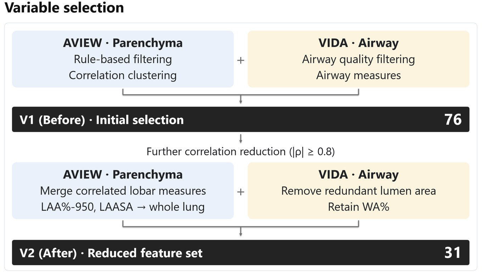
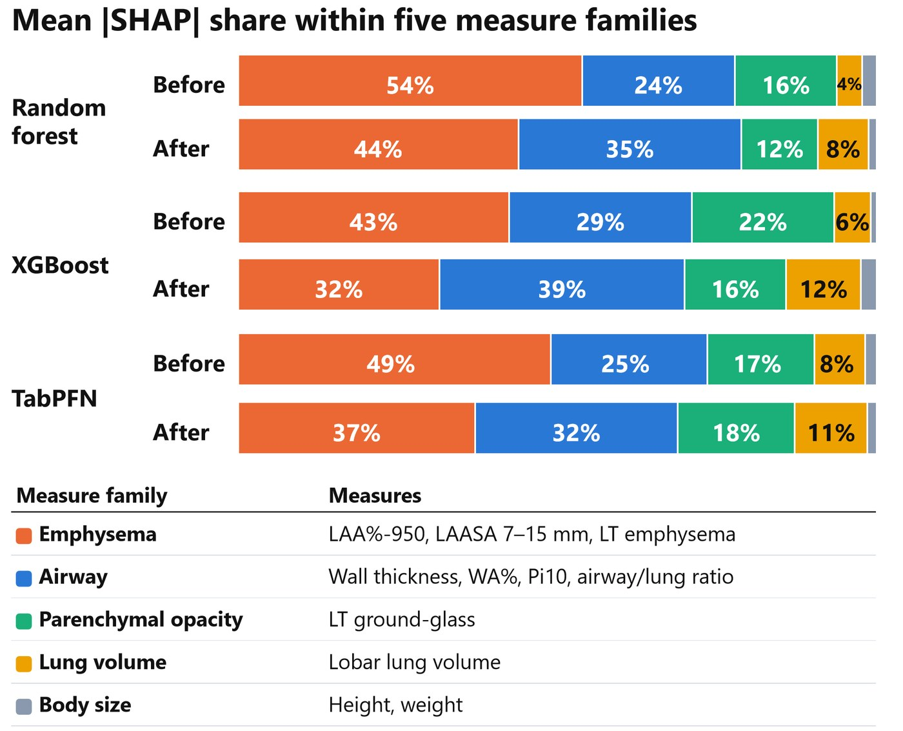

::: {.project-meta}
In progress · Aug 2026 – present · S-LAB, Jeonbuk National University
:::

Low-dose CT taken for lung cancer screening yields hundreds of quantitative
measures of the lung parenchyma and the airways, and COPD in those participants
often goes unrecorded. Those measures are also heavily correlated — across lobes,
and between indicators of the same thing. That correlation is the subject here:
when features move together, an attribution method can split or shift credit
between them, so two models that score alike can still disagree about what they
used.

## Data

Two hospitals, both restricted to men once records with missing data or a long gap
between CT and spirometry were dropped:

- **Development** — Hospital A, 878 patients, 181 with COPD (20.6%), under nested
  five-fold cross-validation.
- **External validation** — Hospital B, 155 patients, 42 with COPD (27.1%),
  scored without refitting.

The target is airflow limitation, defined as FEV₁/FVC below 0.70. Predictors come
from two software pipelines — parenchymal measures from AVIEW, airway measures
from VIDA — covering emphysema (LAA%-950), high-density area, texture, lumen area,
wall thickness, WA%, Pi10 and the airway-to-lung ratio, taken over five lobes and
core/rind zones, plus height and weight.

A limitation worth stating: the two hospitals used different CT-to-spirometry
intervals, within six months at one and within a year at the other.

## Methods

Random forest, XGBoost and TabPFN are each fitted twice — once on the full
predictor set of 76 measures, once on a reduced set of 31 after correlated
measures were merged or dropped at a threshold of |ρ| ≥ 0.8 — on the same
cross-validation folds.

{fig-alt="Flow diagram of variable selection, from 76 initial predictors down to a reduced set of 31"}

Explanations are read as mean |SHAP| per predictor, summed into the share taken by
each of five measure families: emphysema, airway, parenchymal opacity, lung volume
and body size. The question is not which single feature ranks first but how the
credit divides, and whether the three models divide it the same way.

## Findings

**Accuracy barely moved.** Reducing the predictor set cost at most 0.01 AUROC at
Hospital A and 0.04 at Hospital B. TabPFN led throughout (0.88 internal, 0.80
external before reduction).

**Agreement did not survive it.** On the full predictor set all three models
credited emphysema most (43–54%), followed by the airway family (24–29%). After
correlation reduction they parted: emphysema stayed first for random forest and
TabPFN, while for XGBoost the airway family took the lead (39% against 32%).
Across the three models the emphysema share fell by 10–12 percentage points, with
airway up 7 to 11 and lung volume up 3 to 6.

{fig-alt="Stacked bar chart of SHAP share by measure family, before and after correlation reduction, for random forest, XGBoost and TabPFN"}

Similar accuracy, in other words, did not guarantee similar explanations — which
family a model credits depended on both the predictor set and the model.

## Materials

Presented as a poster, *Explainable AI under Correlated Features: Do Models Agree
on Why? An Application to Airflow Limitation Detection from Quantitative Chest
CT*, at the Korean Data and Information Science Society, Busan, November 2026.

[Poster PDF](files/poster-airway-ct-2026.pdf){.research-btn target="_blank"}

[← All research](research.qmd){.back-link}
