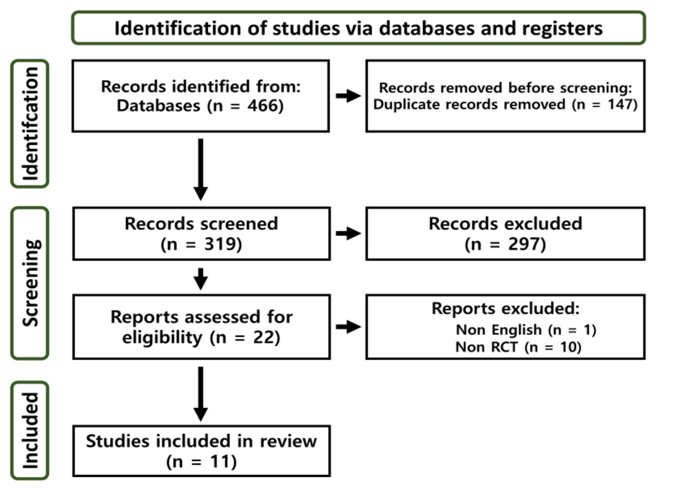
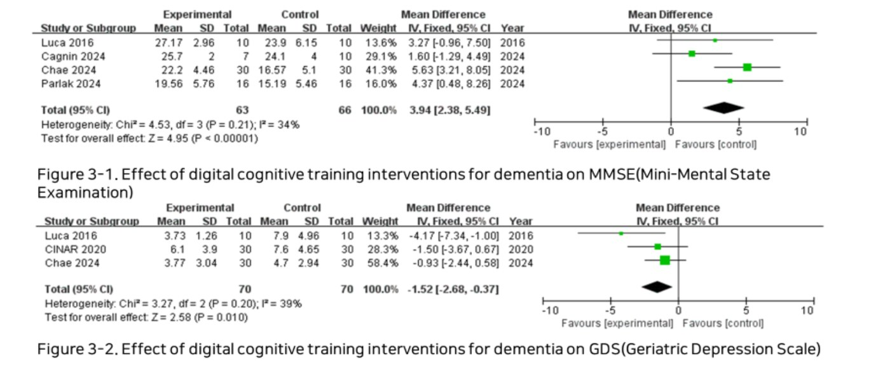

::: {.project-meta}
Poster · **Best Poster Award** · IC-KDA + ASAD 2025 · May 2025, Seoul
:::

A systematic review and meta-analysis of randomized controlled trials asking
whether digital cognitive training — programs delivered remotely through
software, mobile applications or games — improves cognitive and depressive
outcomes in patients with dementia. The protocol was preregistered with PROSPERO
(CRD42025631806). The review was an independent two-person collaboration with
Jiyoun Sung (College of Pharmacy, Seoul National University).

## Data

PubMed, Embase and Cochrane, searched under a PRISMA-based strategy for
English-language randomized controlled trials published through December 2024.
Of 466 records identified, 147 duplicates were removed, 319 screened and 22
assessed in full text, leaving 11 studies covering 1,352 participants (636
intervention, 716 control; mean age approximately 83 in both arms). Patients with
mild cognitive impairment or subjective cognitive decline were excluded.

{fig-alt="PRISMA flow diagram: 466 records identified, 147 duplicates removed, 319 screened, 22 assessed in full text, 11 included"}

## Methods

Pooled mean differences under a fixed-effect inverse-variance model, computed
separately for the two outcomes with enough analyzable data: the Mini-Mental
State Examination (4 studies) and the Geriatric Depression Scale (3 studies).
Heterogeneity was assessed with *I*².

## Findings

| Outcome | Studies | Mean difference | 95% CI | *p* | *I*² |
|---|---|---|---|---|---|
| MMSE | 4 | 3.94 | 2.38 to 5.49 | < 0.00001 | 34% |
| GDS | 3 | −1.52 | −2.68 to −0.37 | 0.01 | 39% |

: Pooled effects of digital cognitive training {.striped}

{fig-alt="Two forest plots, MMSE across four studies and GDS across three, each with a pooled diamond"}

Digital cognitive training improved cognitive scores and reduced depressive
scores, with moderate heterogeneity in both. The evidence base is small — eleven
trials, and only three to four contributing to each pooled estimate — so the
effects are best read as supportive rather than conclusive.

## Materials

Presented as a poster at IC-KDA + ASAD 2025, Seoul, May 2025, where it received
the Best Poster Award. The protocol is registered with PROSPERO
(CRD42025631806).

[Poster PDF](files/poster-dementia-2025.pdf){.research-btn target="_blank"}
[PROSPERO record](https://www.crd.york.ac.uk/prospero/display_record.php?RecordID=631806){.research-btn target="_blank"}

[← All research](research.qmd){.back-link}
