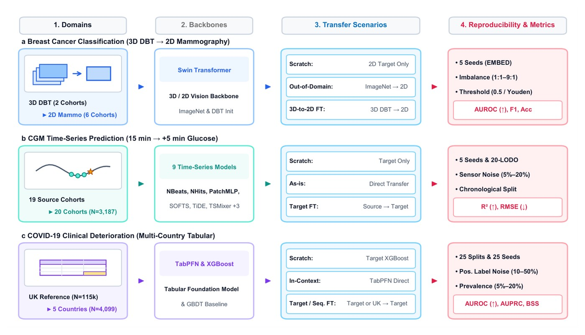

::: {.project-meta}
Manuscript in preparation · Feb 2026 – present · S-LAB, Jeonbuk National University
:::

A medical AI model that scores well at one hospital is expected to carry, with
some adaptation, to the next. Privacy rules keep clinical data siloed by
institution and country, so transfer learning is often the only route — but a
single score from a single training run says little about whether the benefit is
real. Most reported work gives the average gain and not how far it moves between
runs.

This project asks a narrower question: **which stage of the source-to-target
pipeline actually produces the gain**, and whether that gain is larger than the
variation the training configuration induces on its own.

## Design

Three clinical tasks, each isolating one factor while the target evaluation is
held fixed:

| Task | Factor tested |
| --- | --- |
| Breast cancer diagnosis (3D → 2D) | the **kind** of source pretraining, generic against domain-specific |
| Continuous glucose monitoring | the **amount** of target adaptation, direct transfer against fine-tuning |
| COVID-19 clinical deterioration | the **presence** of a large source-domain stage at all |

Every task runs through the same four stages, and every arm is scored on the same
held-out target test set, so each Δ names the two arms it subtracts.

{fig-alt="Four-column schematic with one row per task — breast imaging, glucose time series and COVID-19 tabular data — showing domains, backbones, transfer scenarios, and reproducibility and metrics"}

## Data

- **Breast imaging** — ImageNet-22K and two tomosynthesis cohorts as sources, six
  2D mammography target datasets varying by region, acquisition and image
  dimension.
- **Glucose monitoring** — 20 public cohorts (N = 3,187) from eight countries,
  three sensor manufacturers and five glycemic groups, evaluated
  leave-one-domain-out against a pooled 19-cohort source.
- **COVID-19 deterioration** — a UK reference cohort of 114,987 patients and five
  target countries of 122 to 2,095 patients, with event rates from 10.9% to
  45.1%; 25 data splits each.

## Findings

**The gain almost always points the same way, but its size does not — and in two
of the three tasks the stage everyone assumes is doing the work is not the stage
doing the work.**

### Breast imaging — the kind of pretraining matters most when the data are hard

Pretraining on 3D tomosynthesis before fine-tuning on 2D mammography added +0.033
to +0.203 AUROC over ImageNet alone across the five target datasets, and +0.191
to +0.263 over an equivalent model with no ImageNet stage at any point. The
interesting part is where that margin comes from.

{fig-alt="Line chart of test AUROC against positive training rate for three initializations; the tomosynthesis-pretrained model stays highest and declines least as imbalance increases"}

Domain-specific pretraining was also the most reproducible: across five seeds its
AUROC standard deviation was 0.0052, against 0.0241 for ImageNet-only and 0.0479
for the no-ImageNet model.

### Glucose monitoring — the gain is in the pooling, not in the transfer

Averaged over nine architectures, transferring from a pooled source cut test RMSE
by 28.4% against training on the target cohort alone. Almost all of it was
already there before any target update: the pre-trained model used as-is reached
2.71 of the 2.73 mg/dL reduction, and ten further epochs of target fine-tuning
moved the result by at most 0.04 mg/dL.

{fig-alt="Two scatter plots of transfer RMSE against target-only RMSE on logarithmic axes with a diagonal reference line, for 20-cohort leave-one-domain-out transfer and for single-source transfer"}

Pooling also flattened the choice of architecture. Training on the target alone,
RMSE ranged from 4.27 to 12.88 mg/dL across the nine models; after pooled
pretraining, from 4.23 to 5.01. The weaker five architectures gained 41% to 63%,
the four strongest 1% to 4% — so most of what looks like a transfer-learning
result is the weaker models catching up.

### COVID-19 deterioration — a tabular foundation model beats a tuned baseline, and the adaptation strategy barely registers

{fig-alt="Three-panel figure: study design with five target countries, AUROC by country for four strategies, and a paired win-count heatmap across 25 data splits"}

In-context learning with the tabular foundation model raised mean AUROC over
XGBoost in every country — by 0.017 to 0.019 in the Netherlands at the low end
and 0.060 to 0.072 in Canada at the high end. Adding target fine-tuning on top,
or an extra source-domain stage on the UK reference cohort before it, changed
almost nothing.

### The configuration moves the score more than the method does

{fig-alt="Bar chart comparing the standard deviation of AUROC across data splits versus across model seeds, for five countries and four modelling strategies"}

This is the result that frames all the others. In the two smallest cohorts —
Bolivia and Canada, whose test sets hold 11 and 14 events — the split-to-split
standard deviation reaches 0.097, larger than every between-method difference
reported above. A single reported AUROC from a single split cannot distinguish a
method that works from a split that was kind.

The pattern that matters for practice: the stage that helps is not the same stage
in every domain, the later and more expensive stages of adaptation bought almost
nothing in two of three tasks, and any gain smaller than the configuration's own
spread should not be read as a gain at all.

[← All research](research.qmd){.back-link}
